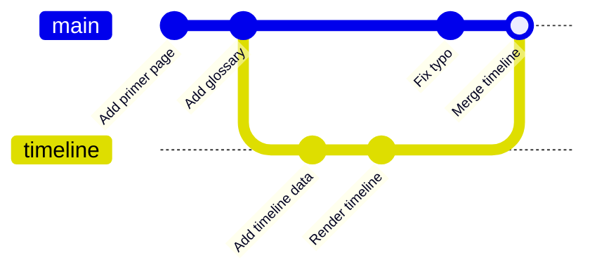

# 01 · How Git works

**Goal:** a mental model that makes everything else make sense. There's no typing in this lesson, just
read it and poke around in Fork.

⏱️ About 8 minutes.

## Commits are snapshots

A **commit** is a snapshot of *every* file in the project at a moment in time, plus:

- who made it and when,
- a message saying why,
- a pointer to its **parent** commit (the one that came before).

Each commit gets an ID (a hash like `5b47f5f…`) calculated from its contents. Change anything (a file,
the message, the parent) and you get a different ID. That's why history in Git is so hard to corrupt
by accident.

Because every commit points to its parent, history forms a **graph**. That's the "train tracks" you see in
Fork.

## Branches are just labels

A **branch** is a movable label pointing at one commit. Nothing more. When you commit on a branch, Git
creates the new commit and moves the label forward to it.

**`HEAD`** means "where you are right now", normally the branch you have checked out.



Here `main` and the `timeline` branch split after *Add glossary*, each got its own commits, and then the
feature was merged back with a **merge commit** that has *two* parents.

Creating a branch is instant and costs almost nothing, because it's only a label. Use them freely.

## The four places your work lives

```text
 Working directory  ──git add──▶  Staging area  ──git commit──▶  Local repo  ──git push──▶  Remote (GitHub)
  (your files)                    ("index")                      (.git folder)              (origin)
                       ◀─────────────────────── git pull / git fetch ◀─────────────────────────
```

- **Working directory:** the files you edit.
- **Staging area:** the changes you've picked for the *next* commit. This lets you commit part of your
  work and leave the rest.
- **Local repository:** your commits, in the hidden `.git` folder. Committing is local and offline.
- **Remote:** a copy elsewhere, usually GitHub, called `origin` by default. Nobody sees your commits
  until you **push**.

In Fork, **Local Changes** shows the first two (the *Unstaged* and *Staged* panes), and **All Commits**
shows the last two as the graph. Remote branches have labels like `origin/main`.

## Try it

1. Open the repo in Fork and click **All Commits**. Find the `main` label and `origin/main`. They point at
   the same commit, because you haven't changed anything yet.
2. Click a commit and look at the files and diff it introduced.
3. The same view in the terminal:

   ```sh
   git log --oneline --graph --all --decorate
   ```

4. Look at the labels on the left of each line. Which commit does `HEAD -> main` point at?
5. Find the `practice/*` branches. Notice they all branch off the same commit: each one is just a label
   on a short line of commits.

## What you should see

A mostly straight line on `main`, with the `practice/*` branches sticking out to the side like sidings off
the main line.

## Stretch

- Run `git cat-file -p HEAD`. That's the raw commit: a `tree` (the snapshot), a `parent`, author and
  message. Then `git cat-file -p HEAD^{tree}` to see the snapshot's files.
- Look inside `.git/refs/heads/`. Each branch is a tiny file containing a commit ID. That's literally
  all a branch is (some may live in `.git/packed-refs` instead).
- `cat .git/HEAD`: what does it contain?

Next: [02 · The basic loop](02-basic-loop.md)
