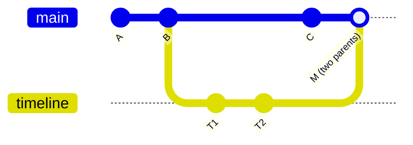

# 03 · Branches and merging

**Goal:** do work on a feature branch, merge it back, and recognise the two kinds of merge on the graph:
**fast-forward** and **merge commit**.

⏱️ About 12 minutes.

## Concept

A branch lets you work on something without disturbing `main`. When you're done, you **merge** it back.
Git does one of two things:

**Fast-forward:** if `main` hasn't moved since you branched, there's nothing to combine. Git just slides
the `main` label forward to your latest commit. No new commit, and the history stays a straight line.

**Merge commit:** if `main` *has* moved on, the histories have diverged. Git combines both sides and records
a new commit with **two parents**.



Branch names are labels, so you can call them anything. Teams usually use prefixes like `feature/`, `fix/`
or `chore/`.

## Practical

Replace `<name>` with your first name, e.g. `feature/thandi-ai-at-work`.

### Part A: a fast-forward merge (HTML)

1. Make sure you're on an up-to-date `main`, then create a branch:
   - **Fork:** select `main`, click **Branch** in the toolbar, name it `feature/<name>-ai-at-work`, keep
     *Check out after create* ticked.
   - **CLI:** `git switch main` then `git switch -c feature/<name>-ai-at-work`.
2. In [`site/index.html`](../site/index.html), add a new section after *Using AI responsibly*:

   ```html
   <section id="ai-at-work" class="card">
     <h2>AI at work</h2>
     <p>Where could AI save our team time this month? Write one real example here.</p>
   </section>
   ```

3. Refresh the site to check it, then commit: `Add an "AI at work" section`.
4. Switch back to `main` (double-click `main` in Fork, or `git switch main`). Refresh the site: your
   section has gone! It's safe on the branch. Your working directory always reflects the checked-out
   branch.
5. Merge it:
   - **Fork:** right-click `feature/<name>-ai-at-work` → **Merge into 'main'…**, leave the defaults, click
     **Merge**.
   - **CLI:** `git merge feature/<name>-ai-at-work`. Git prints **Fast-forward**.

**What you should see:** still a straight line. `main` and the feature label now point at the same commit.
No merge commit was needed.

### Part B: a real merge commit (JSON)

1. Create another branch from `main`: `git switch -c feature/<name>-timeline`.
2. Add an event to [`site/data/timeline.json`](../site/data/timeline.json) and commit it. Then add a second
   one and commit again (two commits). For example:

   ```json
   {
     "year": 2020,
     "title": "AlphaFold cracks protein folding",
     "description": "DeepMind's AlphaFold 2 predicts protein structures with accuracy close to lab experiments."
   }
   ```

   Run `npm test` before each commit. The timeline on the home page is sorted by year automatically.
3. **Push your branch** so it exists on GitHub:
   - **Fork:** **Push**, and tick *Create tracking reference* (Fork usually does for a new branch).
   - **CLI:** `git push -u origin feature/<name>-timeline` (`-u` links your local branch to the remote one
     so later `git push`/`git pull` just work).
4. Meanwhile, `main` moves on:
   - **Live session:** the facilitator pushes a commit to `main`. Switch to `main` and **Pull**
     (`git switch main`, `git pull`).
   - **Self-paced:** switch to `main` and make a commit yourself, e.g. fix something in `CONTRIBUTORS.md`.
5. Merge your branch into `main` (same as Part A).

**What you should see:** the graph splits into two tracks and joins again at a **merge commit** with two
parents. Click it in Fork to see both parents listed.

### Part C (optional): force a merge commit

Some teams always want a merge commit, so the graph shows where a feature started and ended. Create a
quick branch with one commit, then merge it with **No fast-forward** ticked in Fork's merge dialog, or
`git merge --no-ff <branch>`. Compare it with Part A in the graph.

## How this maps to our day-to-day

On real projects you rarely merge into the main branch on your own machine. You push your feature branch,
open a **pull request** into `develop`, and GitHub does the merge after review. It's the same operation,
just done on the server with a review step in front of it.

## Stretch

- `git branch -vv` shows which remote branch each local branch tracks, and how far ahead or behind it is.
- `git log main..feature/<name>-timeline` lists commits on the feature branch that aren't on `main`.
  Swap the order to see the reverse.
- Delete your merged branches: `git branch -d <branch>` locally, `git push origin --delete <branch>` on
  GitHub. Why does `-d` refuse to delete an unmerged branch, and what does `-D` do?
- Open a pull request on GitHub from your feature branch and look at how GitHub shows the same graph.

Next: [04 · Merge conflicts](04-merge-conflicts.md)
